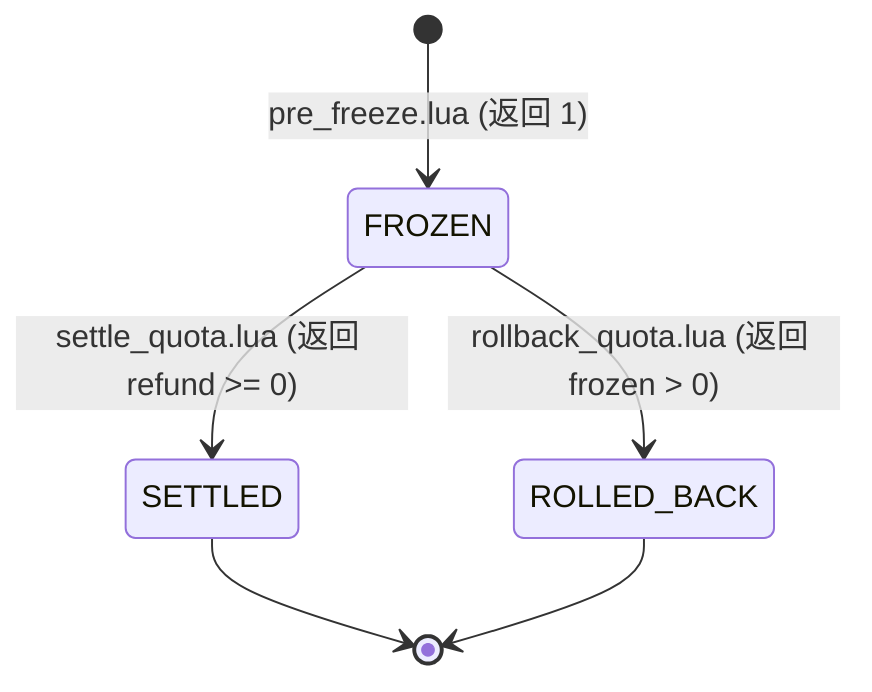

# Redis 与 RabbitMQ 设计

关联文档：[[../README|项目 README]] ｜ [[架构说明]] ｜ [[数据库设计]] ｜ [[../flows/redis-rabbitmq-billing-flow.html|Redis 与 RabbitMQ 计费流程图]] ｜ [[../flows/onegate-billing-sequence.drawio|计费与熔断回滚时序图 (.drawio)]] ｜ [[../flows/onegate-billing-sequence.html|时序图交互式 HTML]]

## 一、Redis 设计

### 1.1 序列化与客户端配置

- 配置类：`com.onegate.billing.config.RedisConfig`
- 统一采用 `StringRedisTemplate`，Key、Value、HashKey、HashValue 全部使用 `StringRedisSerializer`，保证 Lua 脚本可直接用 `tonumber(...)` 对余额和计数进行原子加减。
- 预加载 3 个 `DefaultRedisScript<Long>` Bean：`preFreezeScript`、`settleQuotaScript`、`rollbackQuotaScript`。

### 1.2 Key 命名规范（`RedisKeyConstants`）

| Key 模式 | 数据类型 | TTL | 预热 / 写入方式 | 用途说明 |
|---|---|---|---|---|
| `onegate:quota:avail:{tenant_id}` | `String`（整型） | 永不过期 | 冷启动由 `ensureTenantQuotaWarmUp` 通过 `setIfAbsent` 从 MySQL 载入 | 租户当前可用 Token 余额 |
| `onegate:quota:frozen:{tenant_id}` | `String`（整型） | 永不过期 | 冷启动同上从 MySQL `frozen_quota` 载入 | 租户当前处于冻结中的 Token 总额 |
| `onegate:req:{req_id}` | `Hash` | `86400s`（24h） | `pre_freeze.lua` 写入，结算/回滚脚本更新 | 单次请求状态机凭证，防重放与幂等核心 |
| `onegate:rate:rpm:{tenant_id}:{epoch_min}` | `String`（整型） | `120s` | 首次 `INCR` 后若 `TTL == -1` 则设置 120s 过期 | 自然分钟级（`epochMs / 60000`）RPM 请求频次计数 |

`onegate:req:{req_id}` Hash 字段结构：
- `status`：`FROZEN` / `SETTLED` / `ROLLED_BACK`
- `frozen`：本次预冻结 Token 数（请求未传或 `<= 0` 时，服务端默认防守上限 `500`）
- `tenant_id`：所属租户 ID
- `actual`：实际消耗 Token 数（预冻结时写 `0`，结算后更新）
- `refund`：退还差额 Token 数（预冻结时写 `0`，结算后更新）
- `rollback`：全额回滚 Token 数（`rollback_quota.lua` 成功释放且 `frozen > 0` 时写入）

### 1.3 原子 Lua 脚本与状态机

| 脚本 | 入参（KEYS / ARGV） | 核心原子逻辑 | 返回值契约 |
|---|---|---|---|
| `pre_freeze.lua` | `KEYS[1..4]`：`avail`、`frozen`、`req`、`rpm` `ARGV[1..3]`：`freezeTokens`、`rpmLimit`、`tenantId` | 1. 校验 `req` 不存在（幂等） 2. 校验 `rpm < rpmLimit` 3. 校验 `avail >= freezeTokens` 4. `INCR rpm`（首次设 120s）、`DECRBY avail`、`INCRBY frozen`、写入 `FROZEN` Hash（24h） | `1`：预冻结成功 `0`：`req_id` 已存在（幂等拦截） `-1`：触发 RPM 限流 `-2`：可用余额不足（网关据此 5s 短路） |
| `settle_quota.lua` | `KEYS[1..3]`：`avail`、`frozen`、`req` `ARGV[1]`：`actualTokens` | 1. 校验 `req` 存在且 `status == 'FROZEN'` 2. 计算 `refund = frozen - actual`：若 `>= 0` 则退回 `avail`；若 `< 0` 则从 `avail` 补扣超额并置 `refund = 0` 3. 释放 `frozen`（含不低于 `0` 防守判断） 4. 状态推进为 `SETTLED`，写入 `actual`、`refund` | `>= 0`：结算成功，返回退还差额 `-1`：单据不存在或已非 `FROZEN` 终态（幂等忽略） |
| `rollback_quota.lua` | `KEYS[1..3]`：`avail`、`frozen`、`req` （不接收外部金额，防错账） | 1. 校验 `req` 存在且 `status == 'FROZEN'` 2. 从 `req.frozen` 读取预冻结额；若 `<= 0` 直接标 `ROLLED_BACK` 3. 释放 `frozen`（防负值保护）并全额 `INCRBY avail` 4. 状态推进为 `ROLLED_BACK`，写入 `rollback` | `> 0`：回滚成功，返回全额退回值 `0`：单据已结算或已回滚（空操作忽略） |

---

## 二、RabbitMQ 设计

### 2.1 序列化与并发配置

- 配置类：`com.onegate.billing.config.RabbitMqConfig`
- 消息转换器：`Jackson2JsonMessageConverter`（JSON 格式）
- 消费者监听器参数（`application.yml` `spring.rabbitmq.listener.simple`）：`concurrency: 10`、`max-concurrency: 20`、`prefetch: 20`。

### 2.2 交换机与队列拓扑（`RabbitMqConstants`）

所有交换机均为持久化 `DirectExchange`，所有队列均声明为 `durable`：

| 队列名称 | 绑定交换机 | Routing Key | 特殊参数 / 转发目标 | 用途说明 |
|---|---|---|---|---|
| `onegate.billing.settle.queue` | `onegate.billing.exchange` | `onegate.billing.settle` | 无 | 正常异步结算队列，由 `QuotaSettleConsumer` 消费 `SettleMessage` 并完成事务落库 |
| `onegate.billing.timeout.delay.queue` | `onegate.billing.exchange` | `onegate.billing.timeout.delay` | **无消费者**；`x-message-ttl: 300000`（5 分钟）；DLX → `onegate.billing.dlx.exchange` / `onegate.billing.timeout.rollback` | 预冻结兜底延迟队列；超时未结算消息自动转入死信回滚队列 |
| `onegate.billing.timeout.rollback.queue` | `onegate.billing.dlx.exchange` `onegate.billing.exchange` | `onegate.billing.timeout.rollback` | 双绑定：同时接收死信转发与业务异常直连立即回滚 | 超时/异常回滚处理队列，由 `QuotaTimeoutRollbackConsumer` 消费 |
| `onegate.billing.test.delay.queue` | `onegate.billing.exchange` | `onegate.billing.test.delay` | `x-message-ttl: 2000`（2 秒）；DLX → `onegate.billing.dlx.exchange` / `onegate.billing.timeout.rollback` | 演练/测试专用短延迟队列（配合 `/admin/test/freeze-only`），避免阻塞在 5 分钟生产队列头部 |

### 2.3 消息体契约

1. **`TimeoutCheckMessage`**（`QuotaBillingRpcServiceImpl.preFreezeQuota` 成功后发送至延迟队列）：
   - `reqId`、`tenantId`、`freezeTokens`、`timestamp`
2. **`SettleMessage`**（网关 `ChatCompletionController.sendAsyncSettleMessage` 在模型调用完成后投递至结算队列）：
   - `reqId`、`tenantId`、`frozenTokens`、`actualTokens`、`modelName`、`channelCode`、`timestamp`

### 2.4 当前实现进度

- 已完成全链路：`RabbitMqConfig` 拓扑声明、`QuotaBillingRpcServiceImpl` 预冻结后延迟消息投递、`onegate-gateway-service`（`ChatCompletionController`）成功结算投递 `SettleMessage` 与全失败即时投递 `TIMEOUT_ROLLBACK_ROUTING_KEY`、`QuotaSettleConsumer` 异步结算与补偿落库、`QuotaTimeoutRollbackConsumer` 死信超时回滚落库，以及 `AdminController`（`/admin/test/freeze-only`）秒级死信演练入口。
